<div align="center">

# 江湖残卷

**Fragments of Jianghu**

晚清武侠 · 单机卡牌构筑 · 离线游玩

[下载游戏](https://github.com/Qswhisper/fragments-of-jianghu/releases/latest) · [更新记录](https://github.com/Qswhisper/fragments-of-jianghu/releases) · [问题反馈](https://github.com/Qswhisper/fragments-of-jianghu/issues)

</div>

[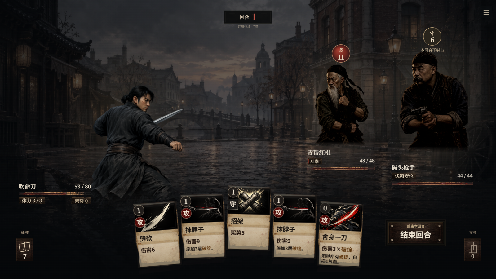](docs/media/battle-tianjin.png)

清末，你带着一份密约穿过五道封锁。挑选招式与旧物，在追兵、旧识和宿敌之间，走完这趟险路。

*An offline wuxia deck-building game set in the late Qing era.*

## 下载与安装

当前版本：**1.0.43**。

| 平台 | 下载 | 安装方式 |
| --- | --- | --- |
| Windows x64 | [完整安装包 EXE](https://github.com/Qswhisper/fragments-of-jianghu/releases/download/v1.0.43/Fragments-of-Jianghu-1.0.43-Windows.exe) | 运行安装程序，自带运行环境 |
| Android 8+ | [安装包 APK](https://github.com/Qswhisper/fragments-of-jianghu/releases/download/v1.0.43/Fragments-of-Jianghu-1.0.43-Android.apk) | 安装后横屏游玩；更新时覆盖安装 |
| PC 浏览器 | [完整离线包 ZIP](https://github.com/Qswhisper/fragments-of-jianghu/releases/download/v1.0.43/Fragments-of-Jianghu-1.0.43-PC.zip) | 解压完整目录，用 Chrome 或 Edge 打开 `play.html` |

游戏可离线运行，进度保存在本机，各平台存档独立。浏览器版升级时请保留原文件路径、浏览器及用户配置；卸载或清除应用数据会影响进度。Windows 安装包目前未作数字签名。

## 玩法

- **四种流派**：吹命刀、外家横练、下三滥、贴身短打，各有不同的出招节奏。
- **构筑取舍**：在招式、升级与旧物之间选择，围绕所选流派调整打法。
- **宿敌记忆**：旧战中的招式会被记住，宿敌重逢时会作出回应。
- **选择留痕**：穿过五卷路线，部分事件会影响后续遭遇与人物回应。

## 游戏画面

### 刀与枪

南下渡口 · 下三滥

[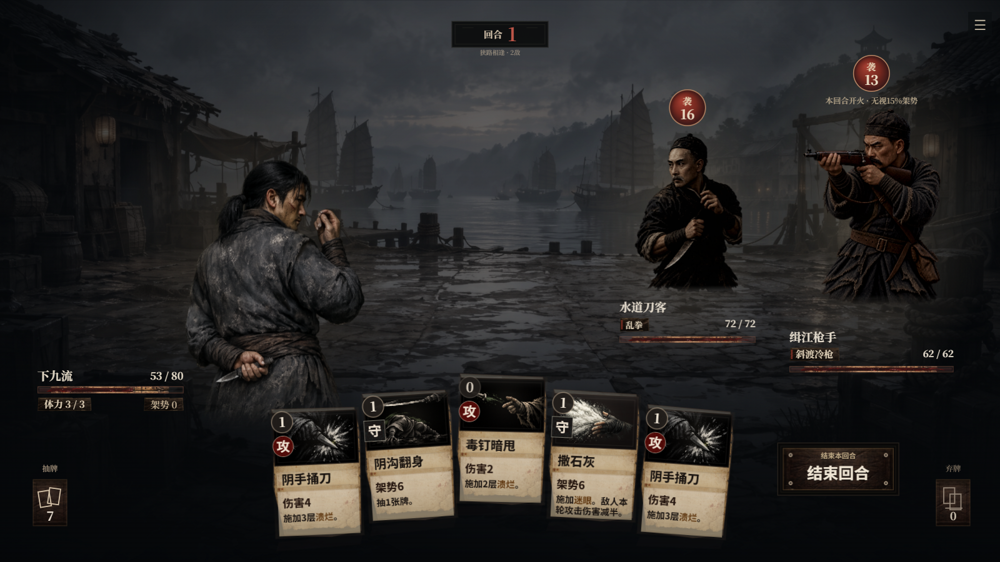](docs/media/battle-river.png)

| 租界关口 · 外家横练 | 北洋铁路营 · 贴身短打 |
| --- | --- |
| [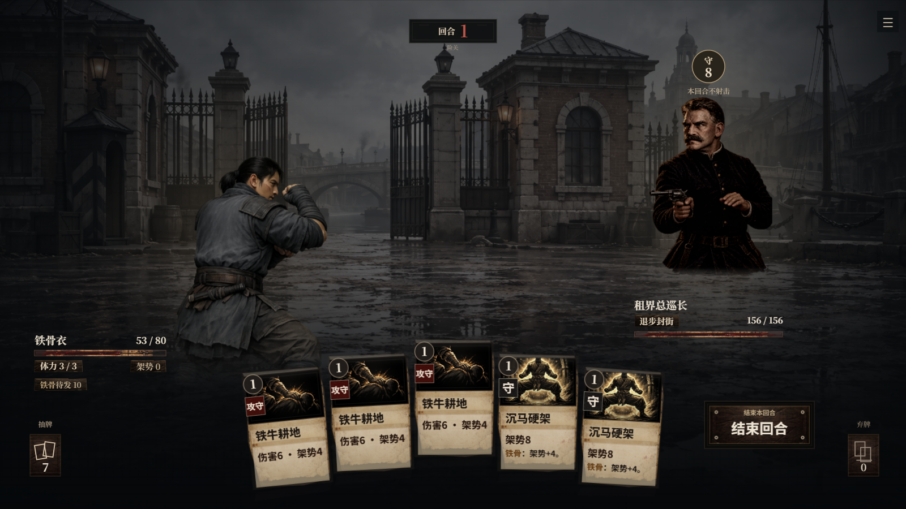](docs/media/battle-inspector.png) | [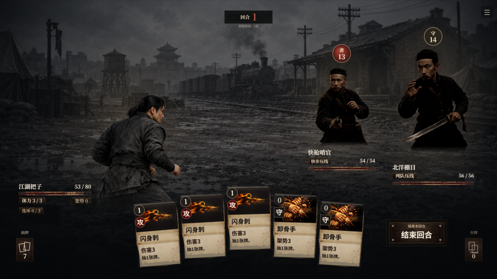](docs/media/battle-railway.png) |

### 暗巷与旅途

暗巷黑市 · 购招、寻旧物、撤去旧招

[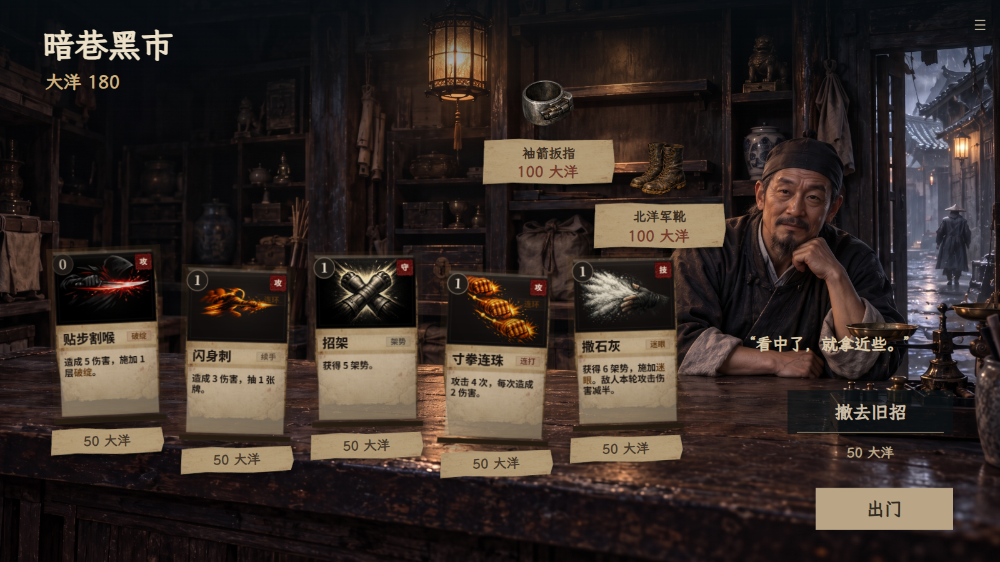](docs/media/shop.png)

| 焦土驿道 · 选择前路 | 破庙暂歇 · 养伤练招 |
| --- | --- |
| [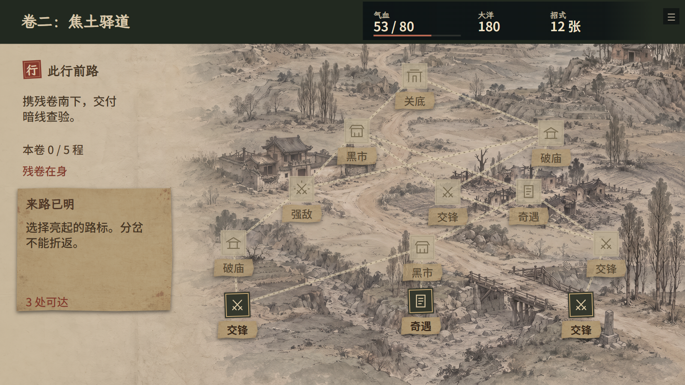](docs/media/map-embers.png) | [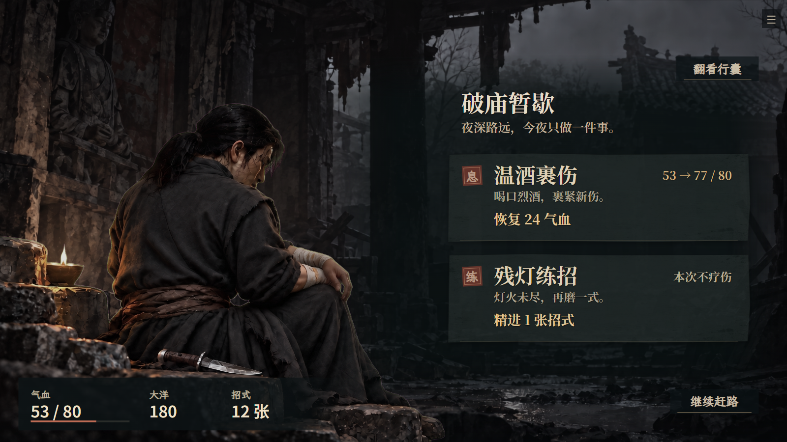](docs/media/rest.png) |

### 旧仇与奇遇

旧仇再会 · 宿敌带着新的准备归来

[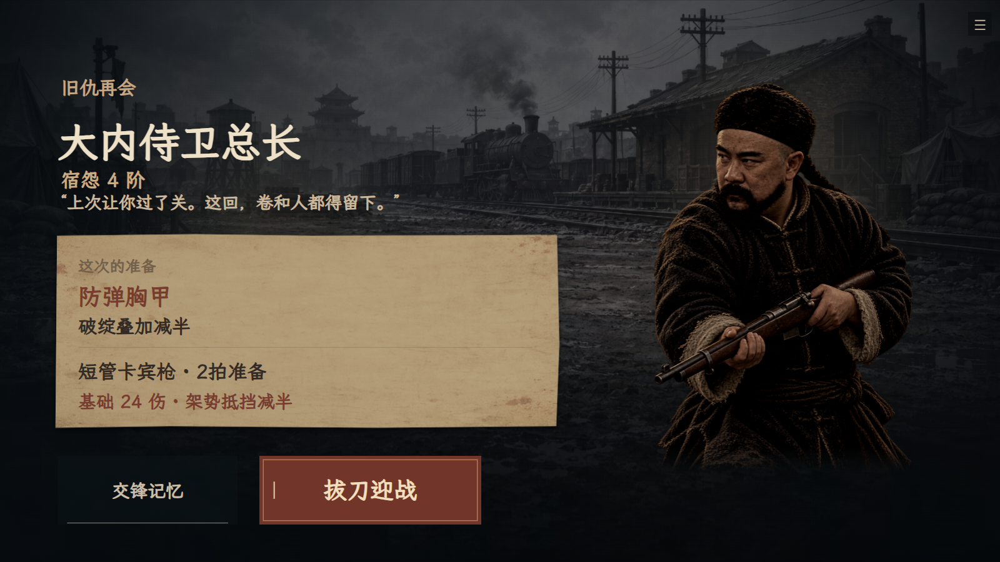](docs/media/nemesis.png)

难民破船 · 渡口的一次抉择

[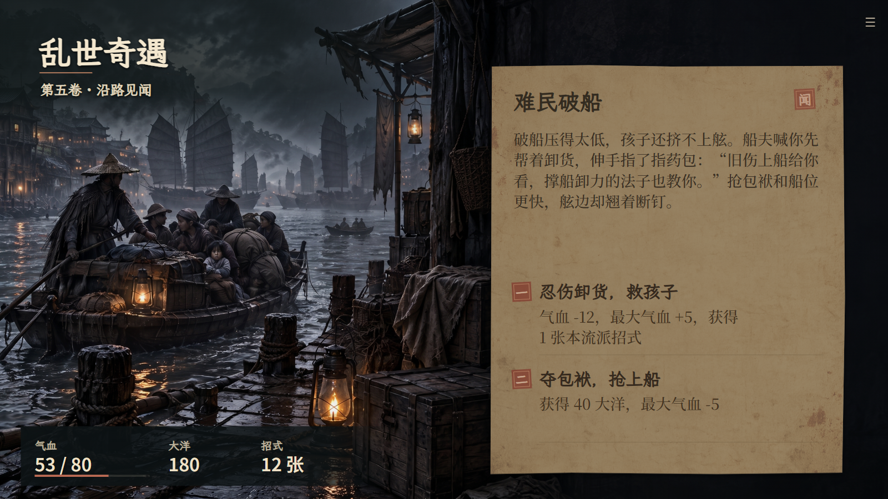](docs/media/event-act5_refugee_boat.png)

| 灰里旧旗 | 雨夜电报局 |
| --- | --- |
| [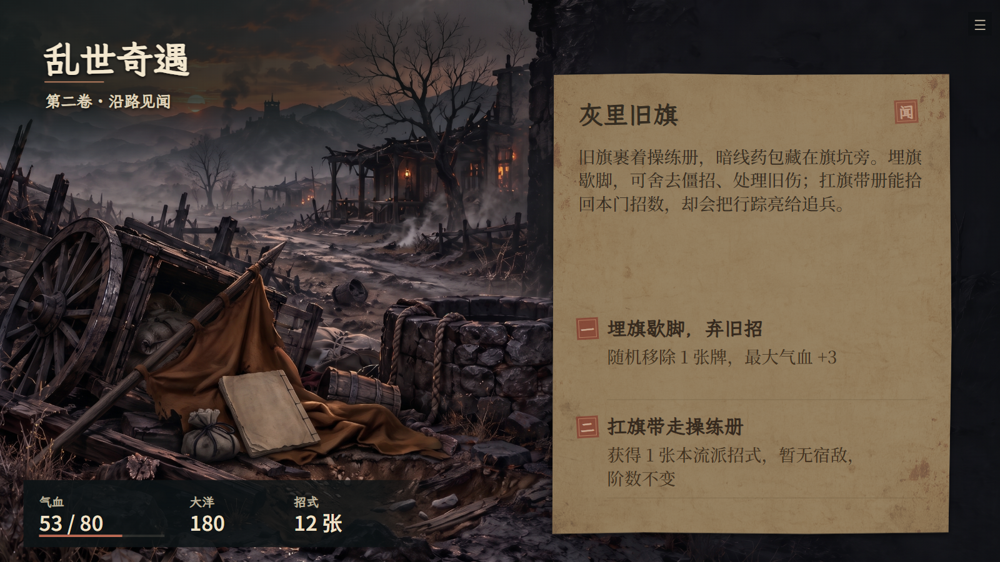](docs/media/event-act2_buried_flag.png) | [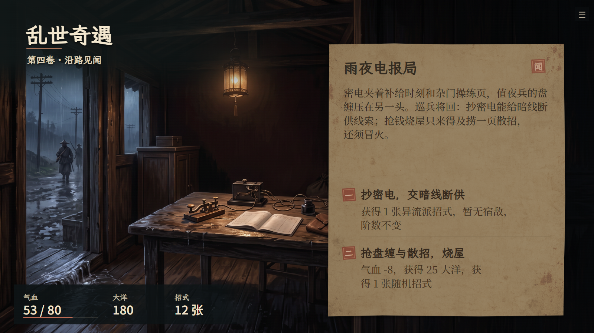](docs/media/event-act4_telegraph_station.png) |

以上为 1.0.43 版本游戏画面，可点击查看原图。

## 开发

<details>
<summary>从源码运行</summary>

需要 Node.js 20+、Python 3.11+。首次运行先恢复游戏资源：

```sh
npm ci
npm run assets:setup
```

随后打开 `play.html`。检查命令为 `npm test`；详见[构建说明](docs/BUILDING.md)。

</details>

## 许可

原创程序代码采用 [MIT](LICENSE)。游戏美术、音乐、字体及截图遵循[素材与第三方声明](THIRD_PARTY_NOTICES.md)。
